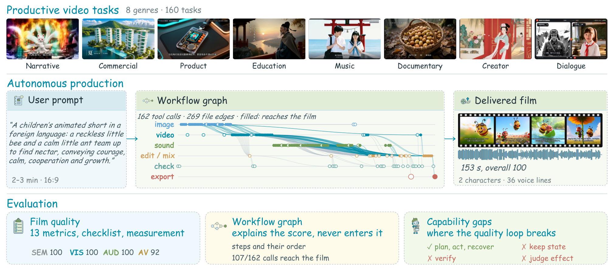
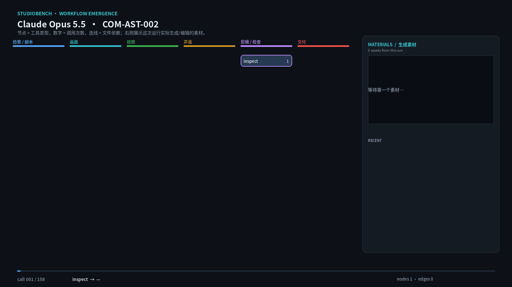
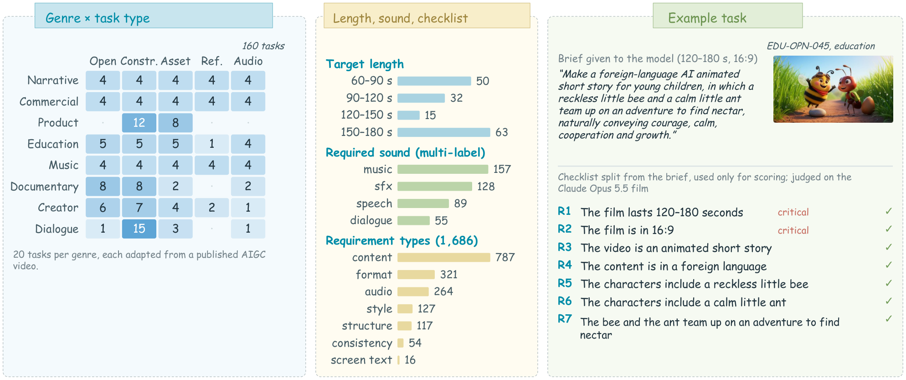
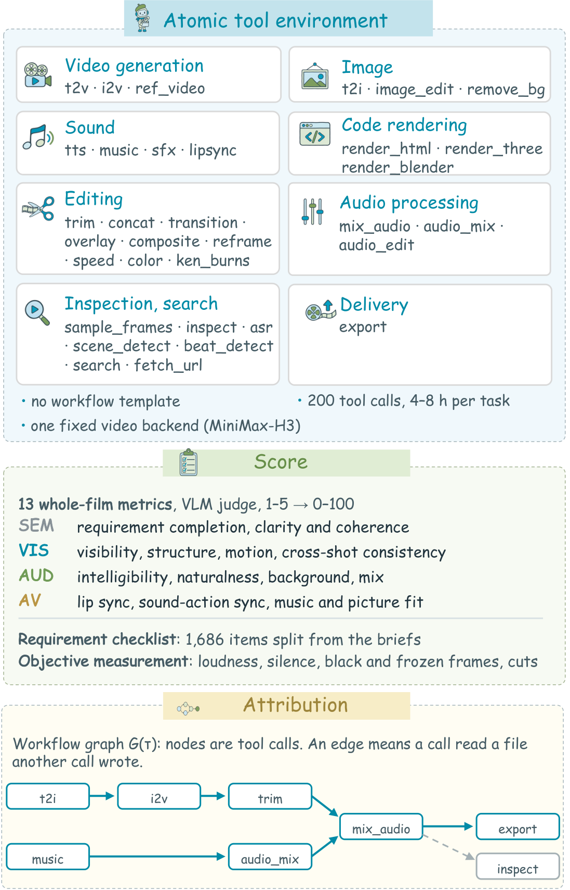
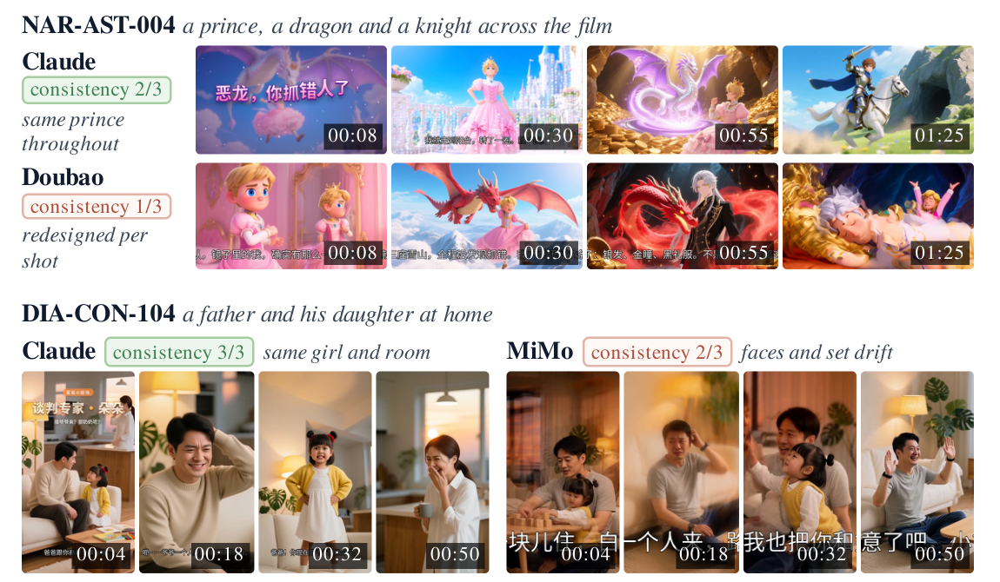
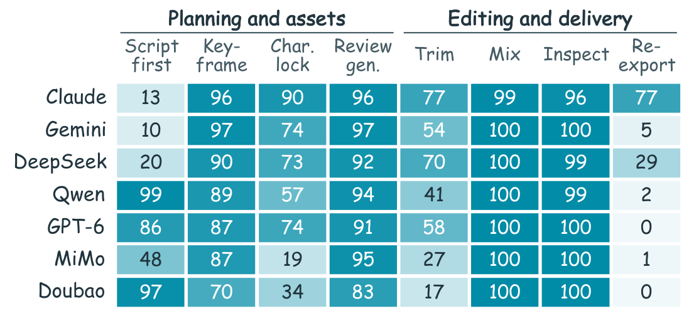
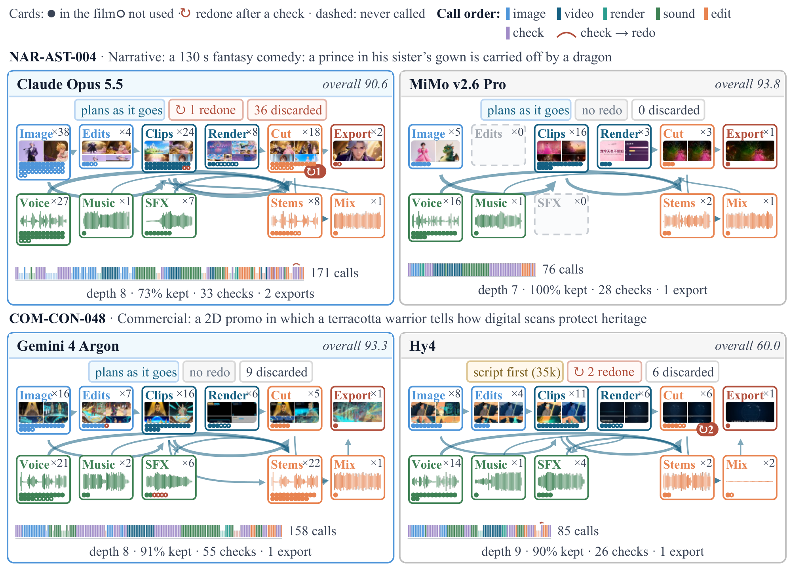

<p align="center">
  <a href="README.md">简体中文</a> · <b>English</b> · <a href="README.ja.md">日本語</a>
</p>

<h1 align="center">🎬 StudioBench</h1>

<p align="center">
  <b>Benchmarking Agentic Multimodal Large Language Models for Productive Audiovisual Creation</b>
</p>

<p align="center">
  <a href="https://openraiser.github.io/StudioBench/"></a>
  <a href="https://openraiser.github.io/StudioBench/leaderboard/"></a>
  
  
  <a href="LICENSE"></a>
  
</p>

<p align="center">
  <a href="https://openraiser.github.io/StudioBench/">🎞️ Demo</a> •
  <a href="https://openraiser.github.io/StudioBench/leaderboard/">🏆 Leaderboard</a> •
  📄 Paper (coming soon) •
  <a href="docs/protocol.md">📖 Docs</a> •
  <a href="#quick-start">🚀 Quick Start</a> •
  <a href="#citation">✒️ Citation</a>
</p>

<p align="center">
  
</p>

**StudioBench** asks whether a multimodal large language model (MLLM) can act as the director of
a real, deliverable audiovisual work. The model receives a production brief adapted from a
published AIGC video and **33 atomic tools** for generation, editing, inspection and delivery —
no shell, no file system, no workflow template. It must plan, generate assets, edit, check its
own work, retry and export a **1–3 minute finished film**. We score only the delivered film, and
reconstruct a *workflow graph* from each run to explain how the film turned out good or bad.

## 🎞️ Showcase

### A workflow graph emerges

<p align="center">
  
</p>

One Claude Opus 5.5 run on `COM-AST-002` (158 tool calls). The model is given only atomic tools
and a brief — no workflow template. Each node is a tool type, the number is how many times it was
called, and an edge means one call consumed a file produced by another. The graph is
reconstructed from the run log and grows as the model plans, generates, reviews and edits. The right-hand panel shows the actual images, video frames and audio waveforms produced during the run.

### Same brief, different models

<table>
<tr>
<td width="33%" align="center"><br><b>Claude Opus 5.5</b><br>Overall 92.2</td>
<td width="33%" align="center"><br><b>Gemini 4 Argon</b><br>Overall 92.0</td>
<td width="33%" align="center"><br><b>GPT-6 Astra</b><br>Overall 88.8</td>
</tr>
<tr>
<td width="33%" align="center"><br><b>DeepSeek V4.1 Flash</b><br>Overall 88.3</td>
<td width="33%" align="center"><br><b>Doubao Seed 2.1 Pro</b><br>Overall 86.9</td>
<td width="33%" align="center"><br><b>Qwen3.8 Max</b><br>Overall 83.9</td>
</tr>
</table>

Six models, one brief (`COM-AST-002`), the same 2.4-second window. The clips loop inline;
longer excerpts are in `docs/assets/cases/`.

## 🔥 News

- **[2026.11.10]** 🏆 The leaderboard of **7 MLLMs × 160 tasks** (1,120 runs) is online.
- **[2026.11.09]** 🎞️ The [process canvas demo](https://openraiser.github.io/StudioBench/) is live: browse every tool call, generated asset and the final cut of curated runs.
- **[2026.11.09]** 🚀 Initial release of the harness, the 33-tool MCP layer with mock backends, the evaluator and the leaderboard generator.

## 👀 Overview

| | |
|---|---|
| 🎯 **Productive tasks** | 160 briefs adapted from published AIGC videos, across **8 genres** (Narrative, Commercial, Product, Education, Music, Documentary, Creator, Dialogue) and **5 task types** (Open Brief, Constraint, Asset-conditioned, Reference-conditioned, Audio-led). |
| 🧰 **Atomic tools only** | Image, video, speech, music, SFX, lip-sync, code rendering, editing, audio processing, inspection and delivery — the model must compose them into a workflow itself. |
| 🎥 **Whole-film evaluation** | 13 whole-film metrics over four dimensions — semantics (**SEM**), visual quality (**VIS**), audio quality (**AUD**) and audiovisual alignment (**AV**) — plus a 1,686-item requirement checklist and objective measurements of production defects. |
| 🕸️ **Workflow graphs** | Nodes are tool calls; an edge means one call consumed a file another call wrote. Graphs explain the score and never enter it. |
| ⚙️ **Fully automatic** | Running, scoring and trace analysis need no human in the loop. Automated judge rankings match human raters across all evaluated models (Spearman ρ = 1.00 on 97 human-rated tasks). |

### Benchmark composition

<p align="center">
  
</p>

Target durations range from 60 to 180 seconds. Sound requirements are multi-label: 157 tasks need
music, 128 sound effects, 89 speech and 55 dialogue. Each brief is split into atomic checklist
items (4–18 per task, 545 marked critical) that are **never shown to the model** and used only for
scoring.

### Environment and scoring

<table>
<tr>
<td width="46%"></td>
<td>

**33 atomic tools**

| Group | Tools |
|---|---|
| Video | `t2v` `i2v` `ref_video` |
| Image | `t2i` `image_edit` `remove_bg` |
| Sound | `tts` `music` `sfx` `lipsync` |
| Code rendering | `render_html` `render_three` `render_blender` |
| Editing | `trim` `concat` `transition` `overlay` `composite` `reframe` `speed` `color` `ken_burns` |
| Audio | `mix_audio` `audio_mix` `audio_edit` |
| Inspection | `sample_frames` `inspect` `asr` `scene_detect` `beat_detect` `search` `fetch_url` |
| Delivery | `export` |

Every model runs under the same system prompt, tool set, generation backends and budget
(200 tool calls, 4–8 hours per task), with one fixed video generator.

**Scoring.** A VLM judge reads the film, its full audio track and sampled frames, and rates
13 metrics on a 1–5 scale with time-stamped evidence, normalized to 0–100. The overall score
is the equal-weight mean of the applicable metrics. A run without a film scores 0, so every
model is averaged over all 160 tasks.

</td>
</tr>
</table>

## 🏆 Leaderboard

Seven MLLMs, 160 tasks each, one run per task–model pair. Scores are 0–100; **Delivered** counts
films out of 160; **Cost** is the median LLM cost per task.

| # | Model | Overall | SEM | VIS | AUD | AV | Delivered | Cost |
|:-:|---|:-:|:-:|:-:|:-:|:-:|:-:|:-:|
| 🥇 | **Claude Opus 5.5** | **92.2** | 96.6 | **86.3** | 95.0 | **89.4** | 156 | \$8.80 |
| 🥈 | Gemini 4 Argon | 92.0 | **97.6** | 83.8 | **95.4** | 88.9 | 159 | \$2.86 |
| 🥉 | GPT-6 Astra | 88.8 | **97.6** | 72.7 | 93.7 | 87.0 | **160** | \$2.57 |
| 4 | DeepSeek V4.1 Flash | 88.3 | 95.1 | 76.5 | 91.8 | 86.5 | 156 | \$3.29 |
| 5 | Doubao Seed 2.1 Pro | 86.9 | 94.2 | 71.6 | 92.8 | 85.0 | **160** | **\$0.75** |
| 6 | Qwen3.8 Max | 83.9 | 92.5 | 69.6 | 87.0 | 83.0 | 152 | \$2.59 |
| 7 | MiMo v2.6 Pro | 63.4 | 71.0 | 51.8 | 67.3 | 60.9 | 120 | \$3.01 |

Claude Opus 5.5 and Gemini 4 Argon are statistically tied (95% bootstrap rank intervals over tasks),
but Gemini costs about a third as much per task; Doubao Seed 2.1 Pro reaches 86.9 at \$0.75.
MiMo v2.6 Pro delivers 75% of its tasks. The interactive board, with human ratings as a reference
column, is at **[openraiser.github.io/StudioBench/leaderboard](https://openraiser.github.io/StudioBench/leaderboard/)**.

## 🔍 Key Findings

**1. Explicit requirements are nearly saturated; craft separates the models.**
A delivered film meets 98% of its checklist items on average, and 81% of films meet every item.
The models differ most in clarity and composition, body and object structure, motion,
background audio, cross-shot consistency and lip sync. On the same brief, Claude Opus 5.5 keeps
its characters across shots, while Doubao Seed 2.1 Pro and MiMo v2.6 Pro let them drift:

<p align="center">
  
</p>

**2. A production workflow emerges without any template.**
Every model generates keyframes before video in 70–97% of runs, reviews generated clips in
83–97%, mixes audio before export in 99–100% and inspects the final film in 96–100%. Strategies
still differ: some models write a full script before any tool call, others plan as they go;
character locking ranges from 19% to 90% of runs and re-exporting after review from 0% to 77%.

<p align="center">
  
</p>

<details>
<summary><b>Two workflow graphs on the same task</b></summary>
<p align="center"></p>
</details>

**3. The quality loop is the bottleneck.**
Models recover from most reported tool errors, yet often miss perceptual defects that raise no
error: a check that only confirms a file or an audio track exists cannot tell a silent or
damaged result from a good one. More tool calls show only a weak association with quality within a model, whereas
stronger models keep a smaller share of what they produce (Spearman ρ = −0.64 across models)
and build deeper workflows (ρ = +0.75) — they explore, select and revise rather than simply do
more.

<a id="quick-start"></a>

## 🚀 Quick Start

No GPU is needed to try the pipeline end to end with mock generation backends.

```bash
git clone https://github.com/OpenRaiser/StudioBench.git
cd StudioBench
python3 -m venv .venv && . .venv/bin/activate
pip install -e ".[frames,ffmpeg]"

# 1. Check that the tool layer is importable and that ffmpeg is present
./sb preflight

# 2. Exercise every tool through the MCP server with mock generation backends
./sb selftest --mock

# 3. Run the scripted mock pipeline end to end (tools -> final.mp4 -> hard-gate eval)
./sb demo --out ./runs

# 4. Inspect the run tree
./sb monitor --runs ./runs --port 8132                 # web dashboard
./sb explorer --runs ./runs --out ./explorer_site       # static case pages
./sb leaderboard --runs ./runs --out ./board_site       # static leaderboard
./sb site --runs ./runs --out ./site --cases DEMO-TINY  # combined Pages build
```

Running a task end to end (`sb run`) drives the evaluated model through the Claude Code CLI with
a strict MCP configuration; see [`docs/protocol.md`](docs/protocol.md). Set `STUDIO_BACKEND=mock`
to run the whole loop without model weights; such runs are marked `valid_for_bench=false`.

## 📦 What Is in This Repository

```
studiobench/
  harness/      isolated runs, batch queue, resume, preflight, selftest
  tools/        MCP server + 33 atomic media tools + model backends (mock included)
  eval/         hard gates, checklist judge, VBench, audio / A-V sync, aggregation
  leaderboard/  snapshot aggregation and static leaderboard
  monitor/      read-only web dashboard for a run tree
  explorer/     static case pages (calls, files, final cut)
  pool/         optional multi-GPU tool pool planner
  results.py    run discovery and the snapshot row format
  sp.md         system prompt used by the evaluated model
tasks/          task format and demo tasks
docs/           protocol, tool contract, metrics, leaderboard, Pages
site/           GitHub Pages build: process canvas and leaderboard
examples/       runnable examples with mock backends
tests/          import / schema / scoring tests (no GPU required)
```

> **Status:** early public release. The core pipeline runs; packaging and docs are still being
> cleaned up.

<details>
<summary><b>📝 Task format</b></summary>

A task is a small JSON document:

```json
{
  "id": "DEMO-001",
  "domain": "commercial",
  "task": "open",
  "audio_profile": ["music", "sfx"],
  "wish": "A one-minute warm concept film for a coffee brand ...",
  "duration_sec": [60, 75],
  "aspect": "16:9",
  "must": [], "forbid": [], "constraints": [], "plot_beats": [], "facts": [],
  "assets": [], "references": [], "given_audio": null
}
```

The model sees the brief (`wish`), input assets, references, the given audio, the duration range
and the aspect ratio. Checklist fields (`must`, `forbid`, `constraints`, `plot_beats`, `facts`)
are used only by the judge. [`docs/protocol.md`](docs/protocol.md) describes the eight genres,
five task types, the user message and what the model must never see.

</details>

<details>
<summary><b>🔌 Backends</b></summary>

Every generation tool has a pluggable backend. The public repository ships:

- `mock` — deterministic placeholders, no weights, no network;
- `ffmpeg` tools — editing, inspection and delivery (real);
- optional local backends for image / video / TTS / music / SFX / lip-sync / ASR;
- an HTTP-job backend for any provider that speaks a simple submit/poll protocol.

Backends are configured through environment variables (see
[`config.example.env`](config.example.env)). Nothing is enabled unless the corresponding variables
are set; unavailable tools are marked as such in `tools/list` and the run is flagged
`valid_for_bench=false`.

</details>

<details>
<summary><b>📏 Metrics and leaderboard tooling</b></summary>

Hard gates (decodable, duration, aspect, audio track, not silent) are computed first with ffprobe.
Metric implementations live in `studiobench/eval/`; definitions and aggregation rules are in
[`docs/metrics.md`](docs/metrics.md).

`studiobench.leaderboard` turns a snapshot directory of evaluation results into a static site,
and `sb leaderboard-import` builds the site from a published board CSV. The repository ships the
generator and the schema, not production data. See [`docs/leaderboard.md`](docs/leaderboard.md);
Pages build and media curation are in [`docs/pages.md`](docs/pages.md).

</details>

## 📜 License

Code is released under [Apache-2.0](LICENSE). Task text and documentation are released under
CC BY 4.0 unless stated otherwise. Third-party reference videos are **not** redistributed; tasks
carry brief text only.

## 🤝 Contributing

Please open an issue before large changes, and run `pytest` and `./sb selftest --mock` before
sending a pull request. See [`CONTRIBUTING.md`](CONTRIBUTING.md).

<a id="citation"></a>

## ✒️ Citation

If you find StudioBench useful, please cite:

```bibtex
@misc{studiobench2026,
  title  = {StudioBench: Benchmarking Agentic Multimodal Large Language Models for Productive Audiovisual Creation},
  author = {StudioBench Team},
  year   = {2026},
  url    = {https://github.com/OpenRaiser/StudioBench}
}
```
