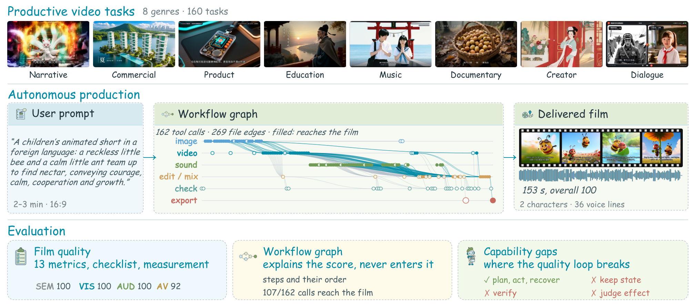
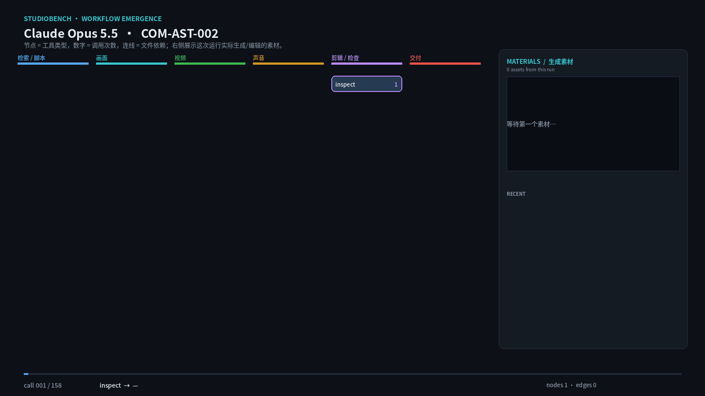
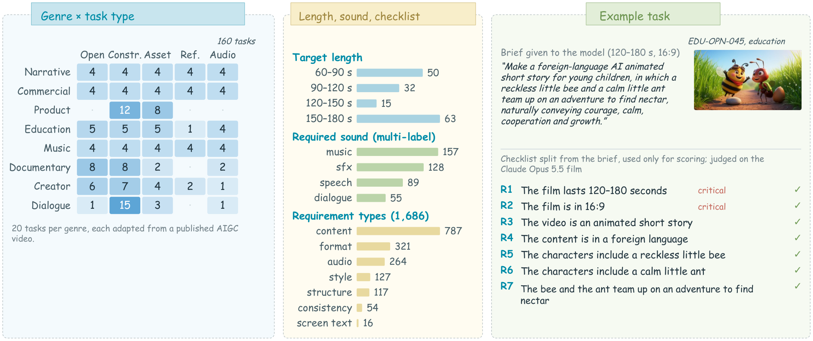
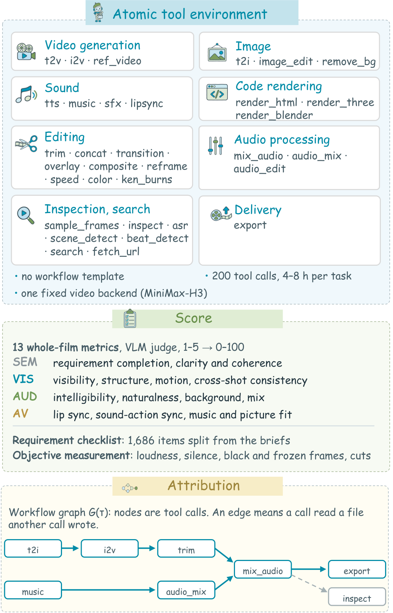
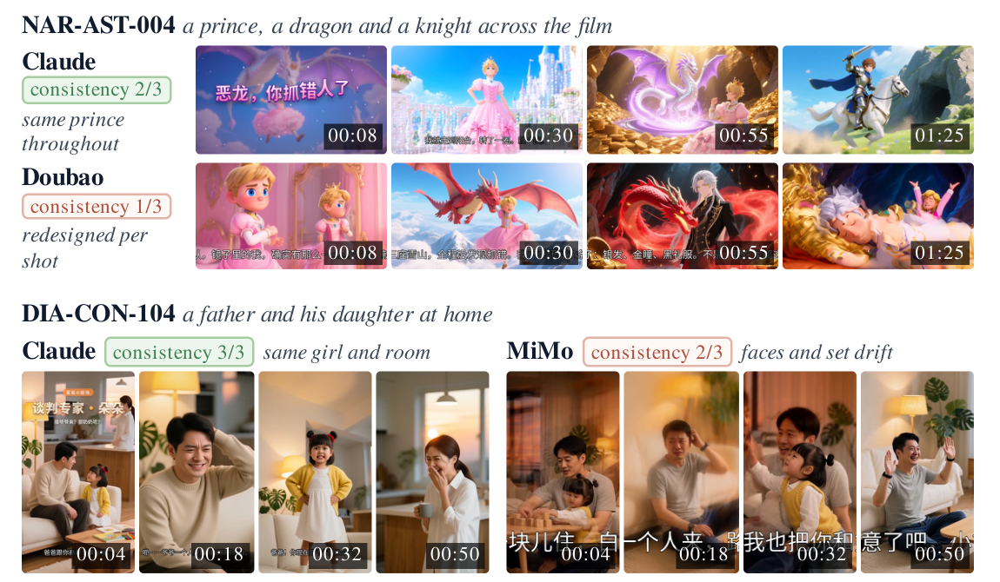
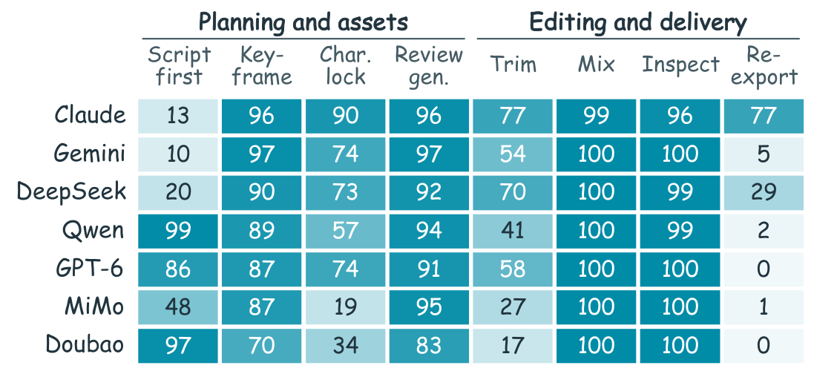
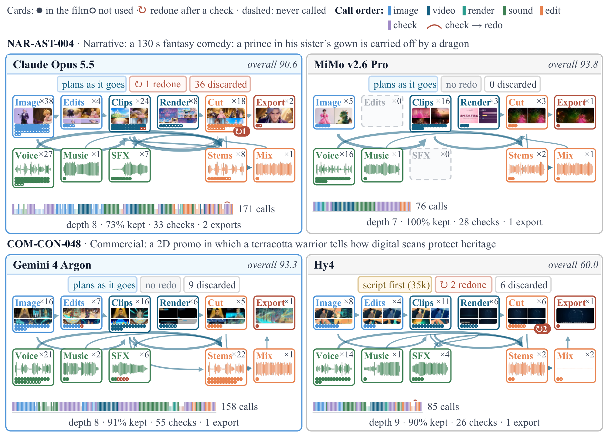

<p align="center">
  <a href="README.md">简体中文</a> · <a href="README.en.md">English</a> · <b>日本語</b>
</p>

<h1 align="center">🎬 StudioBench</h1>

<p align="center">
  <b>プロダクション品質の音声・映像制作におけるエージェント型マルチモーダル LLM のベンチマーク</b>
</p>

<p align="center">
  <a href="https://openraiser.github.io/StudioBench/"></a>
  <a href="https://openraiser.github.io/StudioBench/leaderboard/"></a>
  
  
  <a href="LICENSE"></a>
  
</p>

<p align="center">
  <a href="https://openraiser.github.io/StudioBench/">🎞️ デモ</a> •
  <a href="https://openraiser.github.io/StudioBench/leaderboard/">🏆 リーダーボード</a> •
  📄 論文（近日公開） •
  <a href="docs/protocol.md">📖 ドキュメント</a> •
  <a href="#quick-start">🚀 クイックスタート</a> •
  <a href="#citation">✒️ 引用</a>
</p>

<p align="center">
  
</p>

**StudioBench** は、マルチモーダル LLM が監督のように振る舞い、実際に公開可能な音声・映像作品を納品できるかを問うベンチマークです。モデルには、公開済みの AIGC 動画から書き起こした制作 brief と、生成・編集・検査・納品のための **33 個のアトミックツール** が渡されます。shell もファイルシステムもワークフローテンプレートもありません。モデル自身が計画し、素材を生成し、編集し、検査し、必要ならやり直して、**1〜3 分の完成作品** を書き出さなければなりません。採点対象は納品された作品のみで、各実行から *workflow graph* を再構成し、出来の良し悪しを説明します。

## 🎞️ Showcase

### ワークフローグラフが立ち上がる

<p align="center">
  
</p>

Claude Opus 5.5 が `COM-AST-002` を実行した例（158 回のツール呼び出し）。モデルにはアトミックツールと brief だけが渡され、ワークフローの雛形はありません。各ノードはツール種別、数字は呼び出し回数、エッジは「ある呼び出しが別の呼び出しの生成ファイルを消費した」ことを表します。右側のパネルには、その実行で実際に生成・編集された画像、動画フレーム、音声波形が表示されます。

### 同じ brief、異なるモデル

<table>
<tr>
<td width="33%" align="center"><br><b>Claude Opus 5.5</b><br>Overall 92.2</td>
<td width="33%" align="center"><br><b>Gemini 4 Argon</b><br>Overall 92.0</td>
<td width="33%" align="center"><br><b>GPT-6 Astra</b><br>Overall 88.8</td>
</tr>
<tr>
<td width="33%" align="center"><br><b>DeepSeek V4.1 Flash</b><br>Overall 88.3</td>
<td width="33%" align="center"><br><b>Doubao Seed 2.1 Pro</b><br>Overall 86.9</td>
<td width="33%" align="center"><br><b>Qwen3.8 Max</b><br>Overall 83.9</td>
</tr>
</table>

6 モデル、同じ brief（`COM-AST-002`）、同じ 2.4 秒区間。GIF は README 上でそのままループ再生されます。より長い 6 秒クリップは `docs/assets/cases/` にあります。

## 🔥 News

- **[2026.11.10]** 🏆 **7 MLLM × 160 タスク**（1,120 実行）のリーダーボードを公開。
- **[2026.11.09]** 🎞️ [プロセスキャンバス Demo](https://openraiser.github.io/StudioBench/) を公開。各ツール呼び出し、生成素材、完成作品を閲覧できます。
- **[2026.11.09]** 🚀 初回リリース：harness、33 ツールの MCP レイヤー（mock バックエンド含む）、evaluator、リーダーボード生成器。

## 👀 概要

| | |
|---|---|
| 🎯 **プロダクション向けタスク** | 公開済み AIGC 動画から作った 160 の brief。**8 ジャンル**（ナラティブ、コマーシャル、プロダクト、教育、音楽、ドキュメンタリー、クリエイター、対話）と **5 種類のタスク形式**（オープン、制約、素材条件、参照条件、音声主導）。 |
| 🧰 **アトミックツールのみ** | 画像、動画、音声、音楽、SFX、リップシンク、コードレンダリング、編集、音声処理、検査、納品。モデル自身がこれらをワークフローに組み立てます。 |
| 🎥 **作品全体の評価** | 13 の作品全体指標を 4 次元（意味 **SEM**、映像 **VIS**、音声 **AUD**、音画同期 **AV**）に分類。さらに 1,686 項目の要件チェックリストと客観的な制作欠陥測定。 |
| 🕸️ **ワークフローグラフ** | ノードはツール呼び出し、エッジは「ある呼び出しが別の呼び出しの出力ファイルを消費した」関係。グラフは説明用で、スコアには入りません。 |
| ⚙️ **完全自動** | 実行、採点、軌跡分析に人手は不要。人手評価した 97 タスクで、自動評価のモデル順位は人手順位と Spearman ρ = 1.00。 |

### ベンチマーク構成

<p align="center">
  
</p>

目標長は 60〜180 秒。音声要件はマルチラベルで、157 タスクが音楽、128 タスクが SFX、89 タスクが音声、55 タスクが対話を必要とします。各 brief はアトミックなチェックリスト項目（1 タスク 4〜18 項目、合計 545 項目がクリティカル）に分解されますが、これは**モデルには一切見せず**、採点にのみ使います。

### 環境と採点

<table>
<tr>
<td width="46%"></td>
<td>

**33 個のアトミックツール**

| グループ | ツール |
|---|---|
| 動画 | `t2v` `i2v` `ref_video` |
| 画像 | `t2i` `image_edit` `remove_bg` |
| 音声 | `tts` `music` `sfx` `lipsync` |
| コードレンダリング | `render_html` `render_three` `render_blender` |
| 編集 | `trim` `concat` `transition` `overlay` `composite` `reframe` `speed` `color` `ken_burns` |
| オーディオ | `mix_audio` `audio_mix` `audio_edit` |
| 検査 | `sample_frames` `inspect` `asr` `scene_detect` `beat_detect` `search` `fetch_url` |
| 納品 | `export` |

すべてのモデルは同じ system prompt、ツールセット、生成バックエンド、予算（200 ツール呼び出し、1 タスク 4〜8 時間）で実行され、動画生成器も固定です。

**採点。** VLM judge が作品、音声トラック全体、サンプリングしたフレームを読み、13 指標を 1〜5 で採点し、タイムスタンプ付きの根拠を付けて 0〜100 に正規化します。総合点は適用指標の等重み平均です。作品がない実行は 0 点なので、各モデルは 160 タスク全体で平均されます。

</td>
</tr>
</table>

## 🏆 リーダーボード

7 つの MLLM、各 160 タスク、モデルとタスクの各ペアにつき 1 回実行。スコアは 0〜100、**Delivered** は 160 タスク中何作品を納品したか、**Cost** は 1 タスクあたりの LLM コスト中央値です。

| # | モデル | Overall | SEM | VIS | AUD | AV | Delivered | Cost |
|:-:|---|:-:|:-:|:-:|:-:|:-:|:-:|:-:|
| 🥇 | **Claude Opus 5.5** | **92.2** | 96.6 | **86.3** | 95.0 | **89.4** | 156 | \$8.80 |
| 🥈 | Gemini 4 Argon | 92.0 | **97.6** | 83.8 | **95.4** | 88.9 | 159 | \$2.86 |
| 🥉 | GPT-6 Astra | 88.8 | **97.6** | 72.7 | 93.7 | 87.0 | **160** | \$2.57 |
| 4 | DeepSeek V4.1 Flash | 88.3 | 95.1 | 76.5 | 91.8 | 86.5 | 156 | \$3.29 |
| 5 | Doubao Seed 2.1 Pro | 86.9 | 94.2 | 71.6 | 92.8 | 85.0 | **160** | **\$0.75** |
| 6 | Qwen3.8 Max | 83.9 | 92.5 | 69.6 | 87.0 | 83.0 | 152 | \$2.59 |
| 7 | MiMo v2.6 Pro | 63.4 | 71.0 | 51.8 | 67.3 | 60.9 | 120 | \$3.01 |

Claude Opus 5.5 と Gemini 4 Argon は統計的にほぼ同等（タスク再サンプリングによる 95% 順位区間）ですが、Gemini の 1 タスクあたりコストは約 3 分の 1。Doubao Seed 2.1 Pro は \$0.75 で 86.9 に到達し、MiMo v2.6 Pro は 75% のタスクを納品しました。人手評価の参照列を含むインタラクティブ版は **[openraiser.github.io/StudioBench/leaderboard](https://openraiser.github.io/StudioBench/leaderboard/)** にあります。

## 🔍 主な知見

**1. 明示要件はほぼ飽和し、制作力がモデルを分ける。**
納品作品は平均でチェックリストの 98% を満たし、81% の作品は全項目を満たします。モデル差が大きいのは、明瞭さと構図、人体・物体構造、動き、背景音、ショット間一貫性、リップシンクです。同じ brief でも、Claude Opus 5.5 はショットをまたいでキャラクターを保ち、Doubao Seed 2.1 Pro と MiMo v2.6 Pro は漂います。

<p align="center">
  
</p>

**2. テンプレートなしでも制作ワークフローが自然に生まれる。**
すべてのモデルが 70〜97% の実行で動画前にキーフレームを生成し、83〜97% で生成クリップを確認し、99〜100% で書き出し前に音声をミックスし、96〜100% で最終作品を検査します。戦略には差があり、最初のツール呼び出し前に完全な脚本を書くモデルもいれば、進めながら計画するモデルもあります。キャラクター固定は実行の 19〜90%、確認後の再書き出しは 0〜77% です。

<p align="center">
  
</p>

<details>
<summary><b>同一タスクの 2 つのワークフローグラフ</b></summary>
<p align="center"></p>
</details>

**3. 品質ループがボトルネック。**
モデルは報告されたツールエラーの多くから回復しますが、エラーを出さない知覚的欠陥を見逃します。ファイルや音声トラックの存在だけを確認する検査では、静音・破損した結果と良好な結果を区別できません。ツール呼び出し回数とモデル内品質の相関は弱く、強いモデルほど生成物を残す割合が小さく（モデル間 Spearman ρ = −0.64）、ワークフローが深くなります（ρ = +0.75）。単に多くやるのではなく、探索し、選び、修正しています。

<a id="quick-start"></a>

## 🚀 クイックスタート

mock 生成バックエンドを使えば、GPU なしでパイプライン全体を試せます。

```bash
git clone https://github.com/OpenRaiser/StudioBench.git
cd StudioBench
python3 -m venv .venv && . .venv/bin/activate
pip install -e ".[frames,ffmpeg]"

# 1. ツール層が import でき、ffmpeg があるか確認
./sb preflight

# 2. mock 生成バックエンドで MCP server 経由の全ツールを実行
./sb selftest --mock

# 3. スクリプト化された mock パイプラインを end-to-end 実行
./sb demo --out ./runs

# 4. 実行ツリーを確認
./sb monitor --runs ./runs --port 8132                 # web dashboard
./sb explorer --runs ./runs --out ./explorer_site       # static case pages
./sb leaderboard --runs ./runs --out ./board_site       # static leaderboard
./sb site --runs ./runs --out ./site --cases DEMO-TINY  # combined Pages build
```

タスクを end-to-end で実行する `sb run` は、厳密な MCP 設定で Claude Code CLI を通じて評価対象モデルを動かします。詳細は [`docs/protocol.md`](docs/protocol.md)。`STUDIO_BACKEND=mock` を設定するとモデル重みなしで全体を回せますが、その実行は `valid_for_bench=false` になります。

## 📦 リポジトリ構成

```
studiobench/
  harness/      分離実行、バッチキュー、resume、preflight、selftest
  tools/        MCP server + 33 アトミックメディアツール + モデルバックエンド（mock 含む）
  eval/         hard gates、checklist judge、VBench、音声 / 音画同期、集計
  leaderboard/  スナップショット集計と静的リーダーボード
  monitor/      実行ツリーの読み取り専用 web ダッシュボード
  explorer/     静的ケースページ（呼び出し、ファイル、完成作品）
  pool/         任意のマルチ GPU ツールプールプランナー
  results.py    実行 discovery とスナップショット行形式
  sp.md         評価対象モデルが使う system prompt
tasks/          タスク形式とデモタスク
docs/           protocol、ツール契約、指標、リーダーボード、Pages
site/           GitHub Pages ビルド：プロセスキャンバスとリーダーボード
examples/       mock バックエンドで動く例
tests/          import / schema / 採点テスト（GPU 不要）
```

> **Status:** 早期公開版です。コアパイプラインは動作しますが、パッケージングとドキュメントは整理中です。

<details>
<summary><b>📝 タスク形式</b></summary>

タスクは小さな JSON ドキュメントです。

```json
{
  "id": "DEMO-001",
  "domain": "commercial",
  "task": "open",
  "audio_profile": ["music", "sfx"],
  "wish": "A one-minute warm concept film for a coffee brand ...",
  "duration_sec": [60, 75],
  "aspect": "16:9",
  "must": [], "forbid": [], "constraints": [], "plot_beats": [], "facts": [],
  "assets": [], "references": [], "given_audio": null
}
```

モデルが見るのは brief（`wish`）、入力素材、参照、与えられた音声、長さの範囲、アスペクト比です。チェックリスト項目（`must`、`forbid`、`constraints`、`plot_beats`、`facts`）は judge だけが使い、モデルには見せません。[`docs/protocol.md`](docs/protocol.md) に 8 ジャンル、5 タスク形式、ユーザーメッセージ、モデルに見せてはいけないものが書かれています。

</details>

<details>
<summary><b>🔌 バックエンド</b></summary>

各生成ツールには差し替え可能なバックエンドがあります。公開リポジトリには次が含まれます。

- `mock` — 決定的なプレースホルダー。重みもネットワークも不要。
- `ffmpeg` ツール — 編集、検査、納品（実動作）。
- 任意のローカルバックエンド：画像 / 動画 / TTS / 音楽 / SFX / リップシンク / ASR。
- 単純な submit/poll プロトコルを持つ provider 向けの HTTP-job バックエンド。

バックエンドは環境変数で設定します（[`config.example.env`](config.example.env)）。対応する変数が設定されたときだけ有効になり、使えないツールは `tools/list` でマークされ、実行は `valid_for_bench=false` になります。

</details>

<details>
<summary><b>📏 指標とリーダーボードツール</b></summary>

Hard gates（デコード可能、長さ、アスペクト比、音声トラックあり、無音でない）は最初に ffprobe で計算します。指標の実装は `studiobench/eval/`、定義と集計ルールは [`docs/metrics.md`](docs/metrics.md) にあります。

`studiobench.leaderboard` は評価結果のスナップショットディレクトリを静的サイトに変換し、`sb leaderboard-import` は公開済みの board CSV からサイトを構築します。リポジトリに含まれるのは生成器と schema で、本番データは含みません。[`docs/leaderboard.md`](docs/leaderboard.md)、Pages ビルドとメディア整理は [`docs/pages.md`](docs/pages.md) を参照してください。

</details>

## 📜 License

コードは [Apache-2.0](LICENSE)。タスクテキストとドキュメントは、別記がない限り CC BY 4.0 です。第三者提供の参照動画は**再配布しません**。タスクには brief テキストのみが含まれます。

## 🤝 コントリビューション

大きな変更の前に issue を開いてください。PR の前に `pytest` と `./sb selftest --mock` を実行してください。詳細は [`CONTRIBUTING.md`](CONTRIBUTING.md)。

<a id="citation"></a>

## ✒️ 引用

StudioBench が役に立った場合は、以下を引用してください。

```bibtex
@misc{studiobench2026,
  title  = {StudioBench: Benchmarking Agentic Multimodal Large Language Models for Productive Audiovisual Creation},
  author = {StudioBench Team},
  year   = {2026},
  url    = {https://github.com/OpenRaiser/StudioBench}
}
```
