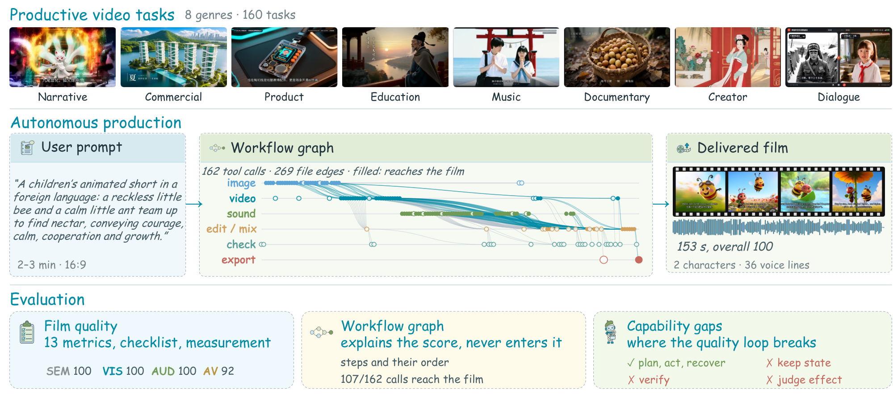
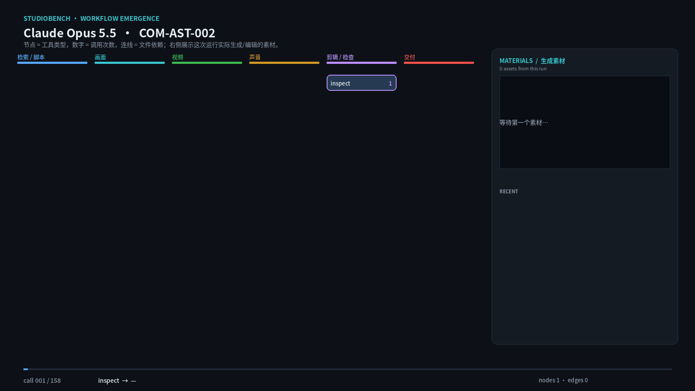
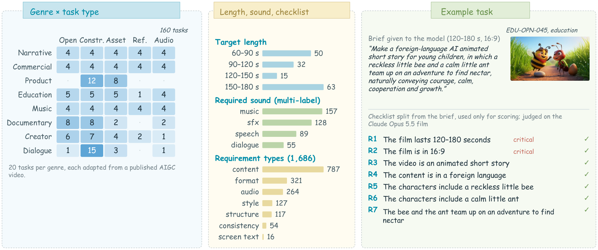
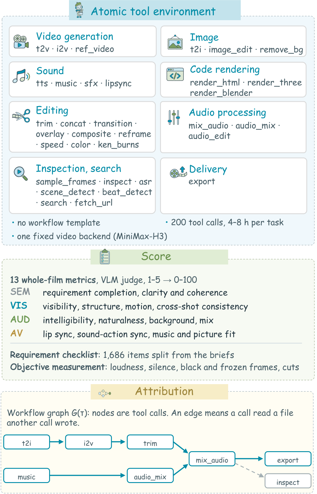
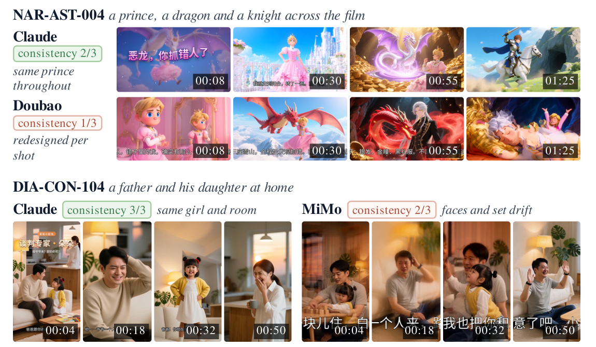
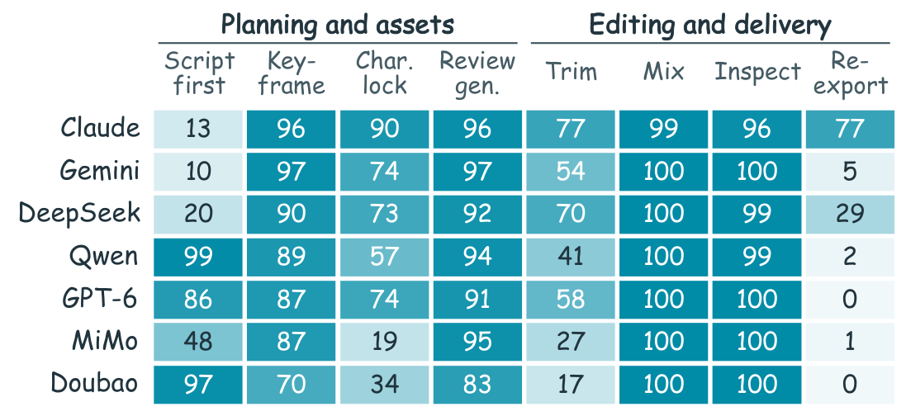
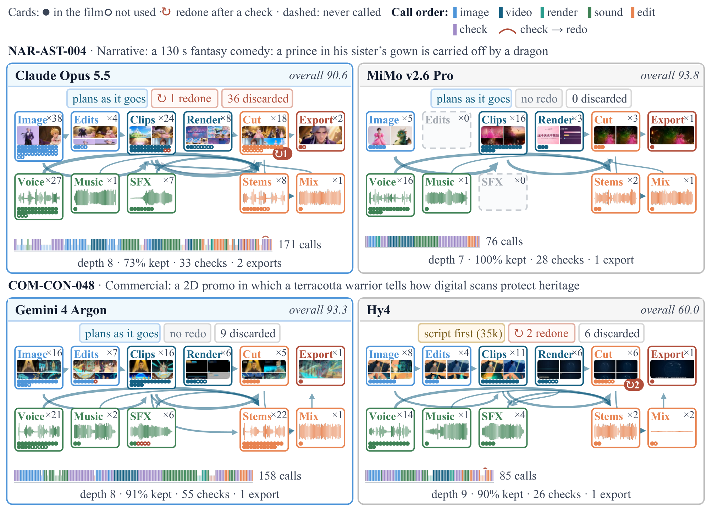

<p align="center">
  <a href="README.md">English</a> · <b>简体中文</b>
</p>

<h1 align="center">🎬 StudioBench</h1>

<p align="center">
  <b>评估智能体式多模态大模型的产品级音视频创作能力</b>
</p>

<p align="center">
  <a href="https://openraiser.github.io/StudioBench/"></a>
  <a href="https://openraiser.github.io/StudioBench/leaderboard/"></a>
  
  
  <a href="LICENSE"></a>
  
</p>

<p align="center">
  <a href="https://openraiser.github.io/StudioBench/">🎞️ 在线 Demo</a> •
  <a href="https://openraiser.github.io/StudioBench/leaderboard/">🏆 排行榜</a> •
  📄 论文（即将发布） •
  <a href="docs/protocol.md">📖 文档</a> •
  <a href="#quick-start">🚀 快速开始</a> •
  <a href="#citation">✒️ 引用</a>
</p>

<p align="center">
  
</p>

**StudioBench** 想回答一个问题：多模态大模型能不能像导演一样，真正交付一部可发布的音视频作品？

模型会拿到一份从已发布 AIGC 视频改写而来的制作 brief，以及 **33 个原子工具**，覆盖生成、剪辑、检查和交付；没有 shell、没有文件系统、也没有工作流模板。模型必须自己规划、生成素材、剪辑、检查、重试，最后导出一部 **1–3 分钟的成片**。我们只对成片打分，并从每次运行中重建一张 *workflow graph*，用来解释片子为什么好、为什么坏。

## 🎞️ Showcase

### 一张工作流图如何长出来

<p align="center">
  
</p>

这是 Claude Opus 5.5 在 `COM-AST-025` 上的一次运行，共 165 次工具调用。模型只拿到原子工具和 brief，没有工作流模板。图中每个节点是一种工具，数字是调用次数，连线表示一次调用消费了另一个工具生成的文件；右侧面板同步展示这次运行实际生成/编辑的图片、视频帧和音频波形。

### 同一个 brief，不同模型

<table>
<tr>
<td width="33%" align="center"><br><b>Claude Opus 5.5</b><br>Overall 92.2</td>
<td width="33%" align="center"><br><b>Gemini 4 Argon</b><br>Overall 92.0</td>
<td width="33%" align="center"><br><b>GPT-6 Astra</b><br>Overall 88.8</td>
</tr>
<tr>
<td width="33%" align="center"><br><b>DeepSeek V4.1 Flash</b><br>Overall 88.3</td>
<td width="33%" align="center"><br><b>Doubao Seed 2.1 Pro</b><br>Overall 86.9</td>
<td width="33%" align="center"><br><b>Qwen3.8 Max</b><br>Overall 83.9</td>
</tr>
</table>

六个模型、同一个 brief（`COM-AST-025`：一支武侠奇幻 3D 动画广告）、同一个 2.4 秒窗口，GIF 直接循环播放。更长的 6 秒片段在 `docs/assets/cases/` 下。

## 🔥 News

- **[2026.11.10]** 🏆 **7 个 MLLM × 160 个任务**（1,120 次运行）的排行榜上线。
- **[2026.11.09]** 🎞️ [流程画布 Demo](https://openraiser.github.io/StudioBench/) 上线：可以浏览每次工具调用、生成素材和最终成片。
- **[2026.11.09]** 🚀 首次发布：harness、33 工具 MCP 层（含 mock 后端）、evaluator 和排行榜生成器。

## 👀 总览

| | |
|---|---|
| 🎯 **生产级任务** | 160 个 brief，来自已发布的 AIGC 视频，覆盖 **8 个品类**（叙事、商业、产品、教育、音乐、纪录、创作者、对话）和 **5 种题型**（开放命题、约束、资产条件、参考条件、音频主导）。 |
| 🧰 **只有原子工具** | 图像、视频、语音、音乐、音效、口型、代码渲染、剪辑、音频处理、检查和交付；模型必须自己把它们组合成工作流。 |
| 🎥 **全片评估** | 13 个全片指标，归入四个维度：语义（**SEM**）、画面（**VIS**）、声音（**AUD**）和音画同步（**AV**）；另有 1,686 条需求 checklist 和客观制作缺陷测量。 |
| 🕸️ **工作流图** | 节点是工具调用，边表示一次调用消费了另一次调用写出的文件；图只用于解释，不进入评分。 |
| ⚙️ **全自动** | 运行、评分和轨迹分析都不需要人工介入。在 97 个人工评过的任务上，自动评审的模型排名与人工排名 Spearman ρ = 1.00。 |

### 基准构成

<p align="center">
  
</p>

目标时长 60–180 秒。声音需求是多标签的：157 个任务需要音乐，128 个需要音效，89 个需要语音，55 个需要对话。每个 brief 会被拆成原子 checklist 条目（每题 4–18 条，共 545 条关键项），这些条目**不会展示给模型**，只用于评分。

### 环境与评分

<table>
<tr>
<td width="46%"></td>
<td>

**33 个原子工具**

| 类别 | 工具 |
|---|---|
| 视频 | `t2v` `i2v` `ref_video` |
| 图像 | `t2i` `image_edit` `remove_bg` |
| 声音 | `tts` `music` `sfx` `lipsync` |
| 代码渲染 | `render_html` `render_three` `render_blender` |
| 剪辑 | `trim` `concat` `transition` `overlay` `composite` `reframe` `speed` `color` `ken_burns` |
| 音频 | `mix_audio` `audio_mix` `audio_edit` |
| 检查 | `sample_frames` `inspect` `asr` `scene_detect` `beat_detect` `search` `fetch_url` |
| 交付 | `export` |

每个模型使用相同的 system prompt、工具集、生成后端和预算（200 次工具调用、每题 4–8 小时），并使用同一个固定视频生成器。

**评分。** VLM judge 读取成片、完整音轨和抽样帧，对 13 个指标按 1–5 打分并给出带时间戳的证据，再归一化到 0–100。总分是适用指标的等权平均；没有成片记 0 分，因此每个模型都在全部 160 题上取平均。

</td>
</tr>
</table>

## 🏆 排行榜

7 个 MLLM，每个 160 题，每个模型-任务对运行一次。分数为 0–100；**Delivered** 是 160 题中交付成片的数量；**Cost** 是每题 LLM 成本的中位数。

| # | 模型 | Overall | SEM | VIS | AUD | AV | Delivered | Cost |
|:-:|---|:-:|:-:|:-:|:-:|:-:|:-:|:-:|
| 🥇 | **Claude Opus 5.5** | **92.2** | 96.6 | **86.3** | 95.0 | **89.4** | 156 | \$8.80 |
| 🥈 | Gemini 4 Argon | 92.0 | **97.6** | 83.8 | **95.4** | 88.9 | 159 | \$2.86 |
| 🥉 | GPT-6 Astra | 88.8 | **97.6** | 72.7 | 93.7 | 87.0 | **160** | \$2.57 |
| 4 | DeepSeek V4.1 Flash | 88.3 | 95.1 | 76.5 | 91.8 | 86.5 | 156 | \$3.29 |
| 5 | Doubao Seed 2.1 Pro | 86.9 | 94.2 | 71.6 | 92.8 | 85.0 | **160** | **\$0.75** |
| 6 | Qwen3.8 Max | 83.9 | 92.5 | 69.6 | 87.0 | 83.0 | 152 | \$2.59 |
| 7 | MiMo v2.6 Pro | 63.4 | 71.0 | 51.8 | 67.3 | 60.9 | 120 | \$3.01 |

Claude Opus 5.5 和 Gemini 4 Argon 在统计上打平（基于任务重抽样的 95% 名次区间），但 Gemini 每题成本约为 Claude 的三分之一；Doubao Seed 2.1 Pro 用 \$0.75 达到 86.9。MiMo v2.6 Pro 交付了 75% 的题目。交互式榜单（含人工评分参考列）在 **[openraiser.github.io/StudioBench/leaderboard](https://openraiser.github.io/StudioBench/leaderboard/)**。

## 🔍 主要发现

**1. 显式要求接近饱和，手艺区分模型。**
交付成片平均满足 98% 的 checklist 条目，81% 的成片满足全部条目。模型差异主要集中在清晰度与构图、人体与物体结构、运动、背景音频、跨镜一致性和口型。同一个 brief 下，Claude Opus 5.5 能让角色跨镜保持一致，而 Doubao Seed 2.1 Pro 和 MiMo v2.6 Pro 会出现漂移：

<p align="center">
  
</p>

**2. 没有模板，也会自发形成生产工作流。**
所有模型都会在 70–97% 的运行里先生成关键帧再生成视频，83–97% 会检查生成片段，99–100% 会在导出前混音，96–100% 会检查最终成片。策略仍有差异：有的模型在第一次工具调用前就写完整脚本，有的边做边规划；角色锁定出现在 19%–90% 的运行中，检查后重新导出的比例从 0% 到 77%。

<p align="center">
  
</p>

<details>
<summary><b>同一任务上的两张工作流图</b></summary>
<p align="center"></p>
</details>

**3. 质量闭环是瓶颈。**
模型能从大多数被报告的工具错误中恢复，但经常漏掉不会报错的感知缺陷：一个只确认“文件存在”或“有音轨”的检查，无法区分静音/损坏的结果和好结果。工具调用次数与模型内质量只有弱相关；更强的模型保留的产出比例更小（跨模型 Spearman ρ = −0.64），工作流更深（ρ = +0.75）——它们在做探索、选择和修改，而不是单纯做更多。

<a id="quick-start"></a>

## 🚀 快速开始

不需要 GPU，用 mock 生成后端就能跑通整条流水线。

```bash
git clone https://github.com/OpenRaiser/StudioBench.git
cd StudioBench
python3 -m venv .venv && . .venv/bin/activate
pip install -e ".[frames,ffmpeg]"

# 1. 检查工具层可导入、ffmpeg 存在
./sb preflight

# 2. 通过 MCP server 跑一遍所有工具（mock 生成后端）
./sb selftest --mock

# 3. 端到端跑脚本化 mock 流水线（tools -> final.mp4 -> hard-gate eval）
./sb demo --out ./runs

# 4. 查看运行目录
./sb monitor --runs ./runs --port 8132                 # web dashboard
./sb explorer --runs ./runs --out ./explorer_site       # static case pages
./sb leaderboard --runs ./runs --out ./board_site       # static leaderboard
./sb site --runs ./runs --out ./site --cases DEMO-TINY  # combined Pages build
```

端到端运行一个任务（`sb run`）会通过 Claude Code CLI 和严格的 MCP 配置驱动被评估模型；见 [`docs/protocol.md`](docs/protocol.md)。设置 `STUDIO_BACKEND=mock` 可以在没有模型权重的情况下跑完整循环；这类运行会标记为 `valid_for_bench=false`。

## 📦 仓库结构

```
studiobench/
  harness/      隔离运行、批处理队列、resume、preflight、selftest
  tools/        MCP server + 33 个原子媒体工具 + 模型后端（含 mock）
  eval/         hard gates、checklist judge、VBench、音频 / 音画同步、聚合
  leaderboard/  快照聚合和静态排行榜
  monitor/      只读的 web 运行看板
  explorer/     静态 case 页面（调用、文件、成片）
  pool/         可选的多 GPU 工具池规划器
  results.py    运行发现和快照行格式
  sp.md         被评估模型使用的 system prompt
tasks/          任务格式和 demo 任务
docs/           protocol、工具契约、指标、排行榜、Pages
site/           GitHub Pages 构建：流程画布和排行榜
examples/       可运行的 mock 后端示例
tests/          导入 / schema / 评分测试（不需要 GPU）
```

> **状态：** 早期公开版本。核心流水线可运行；打包和文档仍在整理中。

<details>
<summary><b>📝 任务格式</b></summary>

一个任务是一个小 JSON 文档：

```json
{
  "id": "DEMO-001",
  "domain": "commercial",
  "task": "open",
  "audio_profile": ["music", "sfx"],
  "wish": "A one-minute warm concept film for a coffee brand ...",
  "duration_sec": [60, 75],
  "aspect": "16:9",
  "must": [], "forbid": [], "constraints": [], "plot_beats": [], "facts": [],
  "assets": [], "references": [], "given_audio": null
}
```

模型会看到 brief（`wish`）、输入资产、参考、给定音频、时长范围和画幅。Checklist 字段（`must`、`forbid`、`constraints`、`plot_beats`、`facts`）只给 judge 使用。[`docs/protocol.md`](docs/protocol.md) 描述了 8 个品类、5 种题型、用户消息以及模型绝对不能看到的内容。

</details>

<details>
<summary><b>🔌 后端</b></summary>

每个生成工具都有可插拔后端。公开仓库提供：

- `mock` — 确定性的占位生成，无需权重、无需网络；
- `ffmpeg` 工具 — 剪辑、检查和交付（真实可用）；
- 可选的本地后端：图像 / 视频 / TTS / 音乐 / 音效 / 口型 / ASR；
- 一个 HTTP-job 后端，适用于任何支持简单 submit/poll 协议的 provider。

后端通过环境变量配置（见 [`config.example.env`](config.example.env)）。只有设置了对应变量才会启用；不可用的工具会在 `tools/list` 中标记，运行会标记为 `valid_for_bench=false`。

</details>

<details>
<summary><b>📏 指标和排行榜工具</b></summary>

Hard gates（可解码、时长、画幅、有音轨、非静音）先用 ffprobe 计算。指标实现位于 `studiobench/eval/`；定义和聚合规则见 [`docs/metrics.md`](docs/metrics.md)。

`studiobench.leaderboard` 把评测结果快照目录转成静态站点，`sb leaderboard-import` 可以从已发布的榜单 CSV 构建站点。仓库提供生成器和 schema，不包含生产数据。见 [`docs/leaderboard.md`](docs/leaderboard.md)；Pages 构建和素材策展见 [`docs/pages.md`](docs/pages.md)。

</details>

## 📜 License

代码使用 [Apache-2.0](LICENSE)。任务文本和文档默认使用 CC BY 4.0，另有说明除外。第三方参考视频**不随仓库分发**；任务只包含 brief 文本。

## 🤝 贡献

大改动前请先开 issue；提交 PR 前请运行 `pytest` 和 `./sb selftest --mock`。见 [`CONTRIBUTING.md`](CONTRIBUTING.md)。

<a id="citation"></a>

## ✒️ 引用

如果 StudioBench 对你有帮助，请引用：

```bibtex
@misc{studiobench2026,
  title  = {StudioBench: Benchmarking Agentic Multimodal Large Language Models for Productive Audiovisual Creation},
  author = {StudioBench Team},
  year   = {2026},
  url    = {https://github.com/OpenRaiser/StudioBench}
}
```
